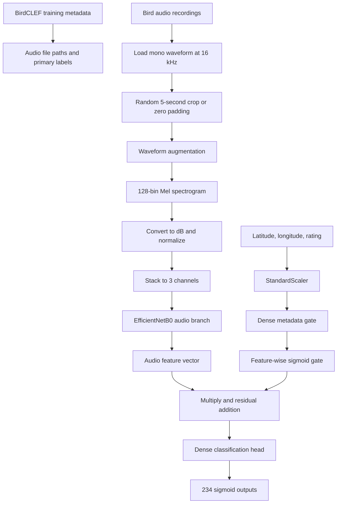
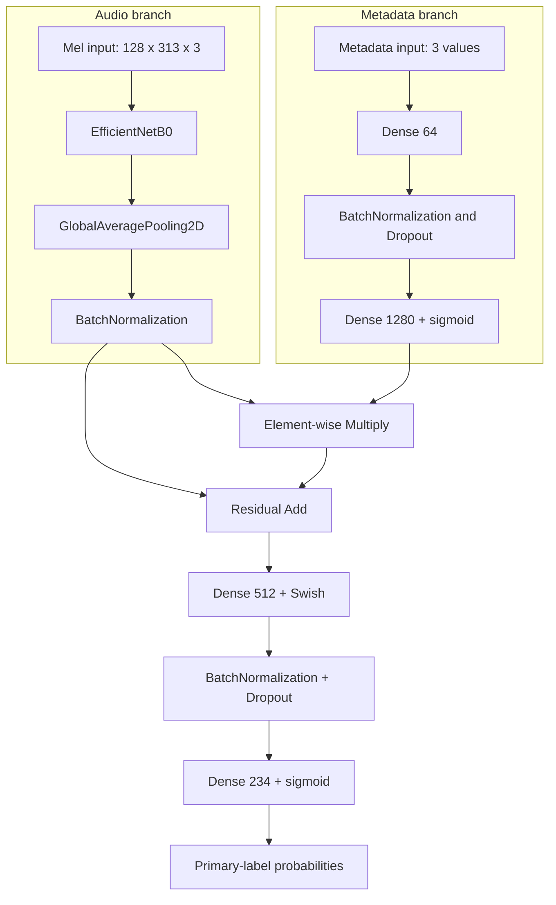

# BirdCLEF 2026 — Audio-Based Bird Species Classification

An experimental deep-learning pipeline for identifying bird species from short audio recordings using **Mel spectrograms**, **EfficientNetB0**, and recording-location metadata. The notebook combines an audio feature extractor with a small metadata branch and fine-tunes a previously saved TensorFlow/Keras model.

> **Project scope:** The current notebook trains a primary-species classifier on labeled training recordings. It explores the BirdCLEF soundscape files but does not yet implement test-soundscape windowing, inference, or generation of the competition `sample_submission.csv`.

<p align="left">
  <a href="https://www.kaggle.com/code/deepanshus167/bird-claasifier-comp?scriptVersionId=321861873">
    
  </a>
</p>

---

## Table of Contents

- [Overview](#overview)
- [Repository Contents](#repository-contents)
- [What the Notebook Does](#what-the-notebook-does)
- [Model Architecture](#model-architecture)
- [Audio Preprocessing](#audio-preprocessing)
- [Dataset](#dataset)
- [Training Configuration](#training-configuration)
- [Recorded Results](#recorded-results)
- [Environment and Dependencies](#environment-and-dependencies)
- [Running the Notebook](#running-the-notebook)
- [Artifacts](#artifacts)
- [Current Limitations and Reproducibility Notes](#current-limitations-and-reproducibility-notes)
- [Possible Next Steps](#possible-next-steps)

## Overview

Bird sounds contain rich acoustic patterns that can help distinguish species. This project processes each recording as a waveform, converts a five-second segment into a normalized Mel spectrogram, and passes the resulting three-channel image through an EfficientNetB0-based audio branch.

Alongside the audio, the model receives three numeric metadata features:

- Latitude
- Longitude
- Recording rating

A metadata network transforms these values into a learned gate that modulates the audio representation before classification. The output layer has **234 sigmoid units**, corresponding to the labels read from the BirdCLEF taxonomy file.

### Main workflow



## Repository Contents

```text
BirdCLEF-2026/
├── bird-claasifier-comp.ipynb   # Main exploration, preprocessing, model and fine-tuning notebook
├── train (1).csv                # Copy of the labeled training metadata CSV
└── README.md                    # Project documentation
```

The notebook filename is kept exactly as it appears in the repository (`claasifier` is the existing spelling). The repository does **not** currently include the full audio directory, the official taxonomy/soundscape files, the earlier model checkpoint loaded by the notebook, or the final fine-tuned model saved during the Kaggle run.

## What the Notebook Does

The notebook `bird-claasifier-comp.ipynb` is organized into these stages:

1. **Load libraries and inspect competition files** — imports NumPy, pandas, TensorFlow, Matplotlib, librosa, and IPython audio display utilities; reads `train.csv` and the soundscape-label metadata from the Kaggle input directory.
2. **Inspect an example recording** — loads an `.ogg` recording, plots its waveform, plays it, and visualizes standard and Mel spectrograms.
3. **Build audio preprocessing functions** — decodes audio paths, resamples to 16 kHz mono, applies a five-second crop/pad policy, and computes normalized Mel spectrograms.
4. **Prepare tabular features** — standardizes latitude, longitude, and rating with `StandardScaler` and saves the fitted scaler as `scaler.pkl` in the Kaggle working directory.
5. **Encode primary-species labels** — reads `taxonomy.csv`, creates a 234-dimensional one-hot vector for each training record's `primary_label`, and checks label coverage.
6. **Create a TensorFlow input pipeline** — shuffles examples, maps preprocessing in parallel, batches them in groups of 16, and prefetches batches.
7. **Load and fine-tune a saved model** — restores a previous Keras checkpoint from a separate Kaggle dataset, unfreezes the EfficientNetB0 backbone except its Batch Normalization layers, and fine-tunes it with focal loss.
8. **Save model artifacts** — writes a best-checkpoint file and a final model file to `/kaggle/working/`.

The notebook also contains commented-out code for a train/validation split, a model definition, and training-history plots. Those commented sections are not part of the active execution path.

## Model Architecture

The loaded model is a two-input Keras Functional model.

### 1. Audio branch

- Input shape: `(128, 313, 3)`
- Backbone: EfficientNetB0
- Global average pooling converts the feature maps to a 1,280-dimensional vector.
- Batch Normalization is applied to the pooled audio features.

### 2. Metadata branch

- Input shape: `(3,)` for standardized latitude, longitude, and rating.
- Dense layer with 64 units.
- Batch Normalization and Dropout.
- A sigmoid Dense layer produces a 1,280-dimensional feature gate.

### 3. Gated fusion and classifier

The metadata gate is multiplied element-wise with the audio vector. A residual addition combines the gated features with the original audio features. The result passes through a 512-unit Dense layer with Swish activation, Batch Normalization, Dropout, and a final 234-unit sigmoid output layer.



The notebook's model summary reports:

| Property | Recorded value |
|---|---:|
| Total parameters | 4,916,365 |
| Trainable parameters after unfreezing | 4,828,614 |
| Non-trainable parameters | 87,751 |
| EfficientNetB0 backbone layers | 238 |
| Trainable backbone layers | 189 |
| Frozen Batch Normalization layers | 49 |
| Output width | 234 |

The active notebook does not construct this model from scratch: it loads `bird_classifier_20epoch_model.keras` from a separate Kaggle dataset. The earlier architecture definition in the notebook is commented out.

## Audio Preprocessing

The active preprocessing path is implemented by `load_audio`, `make_mel_numpy`, and `preprocess_train`.

| Step | Implementation |
|---|---|
| Audio decoding | `librosa.load(..., sr=16000, mono=True)` |
| Target duration | 5 seconds (`80,000` samples at 16 kHz) |
| Long recordings | Random five-second crop during training |
| Short recordings | Zero-pad to the target length |
| Mel bins | 128 |
| FFT size | 1,024 |
| Hop length | 256 |
| Frequency range | 20–8,000 Hz |
| Scaling | Power spectrogram converted to dB, then normalized by its mean and standard deviation |
| Model channels | Same Mel image stacked three times to create a three-channel input |

### Training-time augmentation

The active augmentation function applies stochastic transformations:

- Random waveform gain between 0.7 and 1.3.
- Gaussian waveform noise with standard deviation 0.005, applied with 50% probability.
- Random circular time shift of up to 8,000 samples in either direction, applied with 50% probability.
- Frequency masking with a random frequency range.
- Time masking with a random time range.

The commented-out validation preprocessing function disables augmentation, but no validation loader is created in the active notebook.

## Dataset

### Metadata file in this repository

`train (1).csv` is a copy of the labeled BirdCLEF training metadata. It contains **35,549 rows and 15 columns** in the inspected version.

| Column | Description |
|---|---|
| `primary_label` | Primary target label used by this notebook |
| `secondary_labels` | Additional labels supplied in the metadata |
| `type` | Recording/type metadata |
| `latitude`, `longitude` | Recording coordinates; used as model features |
| `scientific_name`, `common_name` | Species names |
| `class_name` | Taxonomic class |
| `inat_taxon_id` | iNaturalist taxon identifier |
| `author` | Recording contributor metadata |
| `license` | Recording license metadata |
| `rating` | Recording rating; used as a model feature |
| `url` | Source recording URL |
| `filename` | Relative path to the audio file |
| `collection` | Source collection metadata |

The notebook expects the Kaggle competition input directory to contain files and folders such as:

```text
birdclef-2026/
├── sample_submission.csv
├── taxonomy.csv
├── train.csv
├── train_audio/
├── train_soundscapes_labels.csv
├── train_soundscapes/
├── recording_location.txt
└── test_soundscapes/
```

Only `train (1).csv` and the notebook are present in this GitHub repository. The audio and other competition assets must be supplied separately through Kaggle or another authorized source.

### Label encoding

The notebook reads `taxonomy.csv`, builds a label-to-one-hot-vector mapping, and reports:

- Taxonomy output width: **234 labels**.
- Training metadata primary labels represented: **206 distinct labels**.
- Label matrix shape: **(35,549, 234)**.
- Unmatched primary labels: **0**.
- Training rows with all-zero labels: **0**.

Each training row is encoded from its single `primary_label`. Although the model uses sigmoid outputs and a multi-label AUC metric, the active target-construction code creates one-hot targets from the primary label; it does not combine `secondary_labels` into multi-hot targets.

## Training Configuration

The notebook restores a previous checkpoint and fine-tunes it with the following configuration:

| Setting | Value |
|---|---|
| Framework | TensorFlow / Keras |
| Optimizer | Adam |
| Learning rate | `1e-6` |
| Loss | Custom focal loss |
| Focal-loss gamma | `2.0` |
| Focal-loss alpha | `0.25` |
| Metrics | Multi-label AUC and Binary Accuracy |
| Batch size | `16` |
| `epochs` argument | `30` |
| `initial_epoch` | `25` |
| Epochs executed in the recorded run | 26–30 (five additional epochs) |
| Backbone fine-tuning | All EfficientNetB0 layers except Batch Normalization layers |

The data pipeline uses `tf.data`, a shuffle buffer of 2,000, parallel mapping with `tf.data.AUTOTUNE`, batching, and prefetching.

### Focal loss

The notebook defines a binary focal-loss-style function to reduce the contribution of well-classified examples:

\[
\mathrm{FL}(p_t) = -\alpha(1-p_t)^\gamma\log(p_t)
\]

The implementation clips predictions for numerical stability and averages the element-wise focal loss over the batch and output dimensions.

## Recorded Results

The notebook's saved output includes a fine-tuning run for epochs 26–30. The `ModelCheckpoint` callback messages report a best monitored AUC of **0.75580** at epoch 30.

**Interpret this number cautiously:** the active `model.fit` call uses only `train_loader` and does not pass a validation dataset. It is therefore not a held-out validation score or a BirdCLEF leaderboard result. In addition, the saved training output shows progress-bar AUC values around 0.47 while the checkpoint callback reports values around 0.75. This discrepancy should be investigated before treating the metric as a reliable model result.

No held-out evaluation, test-soundscape prediction, official submission generation, or leaderboard score is included in the repository's active notebook output.

## Environment and Dependencies

The notebook imports or installs the following packages:

- Python 3
- NumPy
- pandas
- TensorFlow / Keras
- librosa
- Matplotlib
- scikit-learn (`StandardScaler`)
- IPython (`IPython.display`)
- mutagen (`OggVorbis`, installed in the notebook)

The repository does not currently include a pinned `requirements.txt` or environment file. Package versions should be selected to match the TensorFlow/Keras and librosa APIs used by the notebook.

A GPU is strongly recommended. The notebook's recorded run used Kaggle GPU resources (Tesla T4 devices were listed in the saved runtime output).

## Running the Notebook

### Recommended: Kaggle

The notebook uses Kaggle-specific input paths and expects competition assets and a prior model checkpoint to be attached to the session.

1. Open the [Kaggle notebook](https://www.kaggle.com/code/deepanshus167/bird-claasifier-comp?scriptVersionId=321861873) or upload `bird-claasifier-comp.ipynb` to Kaggle.
2. Join or obtain authorized access to the BirdCLEF 2026 competition data.
3. Attach the competition dataset so the `/kaggle/input/competitions/birdclef-2026/` directory is available.
4. Attach the separate Kaggle dataset containing `bird_classifier_20epoch_model.keras` at the path expected by the notebook, or change the checkpoint path to your own compatible model.
5. Enable a GPU accelerator.
6. Run the cells in order. The notebook installs `mutagen` in a cell; install the other imported libraries if they are not already available in the runtime.
7. Check the generated model and scaler files in `/kaggle/working/` before ending the session or downloading the outputs.

### Local execution

Local execution requires more setup because the current notebook contains hard-coded Kaggle paths. Download the competition assets only from authorized sources, place them in a local directory, and update every `/kaggle/input/competitions/birdclef-2026/` path. Also update the external checkpoint path to a local `.keras` file.

The audio files must preserve the relative paths recorded in the metadata (for example, `<data-root>/train_audio/<filename>`). The notebook currently constructs absolute audio paths in a code cell; adapt that path construction to your local data directory.

## Artifacts

The notebook writes the following files in a Kaggle session:

| Artifact | Purpose | Present in this GitHub repository? |
|---|---|---|
| `scaler.pkl` | Fitted scaler for latitude, longitude, and rating | No |
| `best_focal_model.keras` | Best checkpoint selected by the training callback | No |
| `bird_classifier_focal_30epoch.keras` | Final fine-tuned model saved at the end of the notebook | No |
| `bird_classifier_20epoch_model.keras` | Earlier checkpoint loaded as the starting point | No; expected from a separate Kaggle dataset |

The only model file saved by the notebook is written to Kaggle's working directory. It is not automatically committed to this repository.

## Current Limitations and Reproducibility Notes

1. **Not a complete competition submission pipeline:** the active notebook does not run inference over `test_soundscapes`, construct the required prediction windows, or write a `submission.csv`.
2. **External checkpoint required:** training starts from a `.keras` model stored in a separate Kaggle dataset. That checkpoint is not included here, so the active notebook cannot be reproduced from this repository alone.
3. **No active validation split:** the `train_test_split` and validation preprocessing code are commented out. The current fit call trains on the full training dataset and does not report held-out validation metrics.
4. **Metric discrepancy:** progress-bar AUC values and `ModelCheckpoint` AUC messages in the saved output do not agree. Verify how the metric is being reset, updated, and monitored before reporting performance.
5. **Scaler leakage risk:** `StandardScaler` is fitted on all rows of the training metadata before a validation split is created. A future validation workflow should fit the scaler on the training fold only, then transform validation and test data with that fitted scaler.
6. **No cache in the active data pipeline:** notebook Markdown describes caching, but the actual `tf.data` pipeline uses shuffle, parallel map, batch, and prefetch without `.cache()`.
7. **Python preprocessing inside TensorFlow:** `tf.py_function` calls librosa/NumPy code. This is convenient but can constrain graph optimization and CPU throughput; performance should be profiled.
8. **Primary labels only:** `secondary_labels` and soundscape segment labels are inspected but are not used to build the active training targets.
9. **Five-second segment sampling:** long recordings are represented by one random five-second crop per training example per iteration. This may omit useful events elsewhere in a recording.
10. **Dataset assets are external:** the audio folders, taxonomy, soundscape labels, and test soundscapes are not present in this repository.
11. **Licensing:** the metadata contains per-recording license information. Follow the applicable recording licenses and BirdCLEF/Kaggle competition terms when downloading, redistributing, or using audio.

## Possible Next Steps

- Add an explicit train/validation split before fitting the scaler and creating the training pipeline.
- Create a deterministic validation preprocessing function with augmentation disabled.
- Report validation macro/micro AUC and class-wise metrics, with a clear mapping between output indices and species labels.
- Investigate the callback/progress-bar AUC discrepancy.
- Add an inference pipeline for the test soundscapes using the competition's required temporal windows and output format.
- Generate and validate a submission file against `sample_submission.csv`.
- Export the model, scaler, and taxonomy label mapping together as versioned artifacts.
- Move hard-coded paths and model checkpoints into configuration variables.
- Add a pinned dependency file and a short setup script for reproducible execution.

---

## Disclaimer

This repository is an experimental BirdCLEF 2026 audio-classification workflow. It should not be presented as a finished or validated competition submission system until a held-out evaluation and the complete test-soundscape inference/submission process have been implemented.
